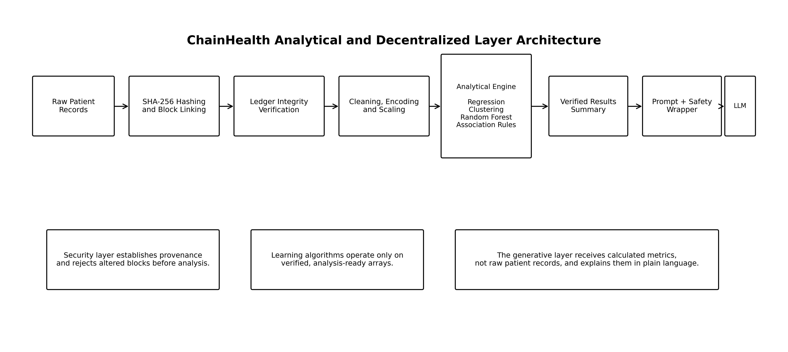

# ChainHealth: Tamper-Evident Heart Disease Analytics

Group project for **Intro to Data Analytics**, UPNM (June 2026).
My role: **Data Scientist / Statistical Lead**.

ChainHealth runs heart disease analytics on records that are first linked into a SHA-256 hash chain, so any later change to a record would change the chain's root hash and be detectable.



## What it does

| Step | Method |
|---|---|
| Integrity | SHA-256 hash chain over all 920 records, producing a single chain root hash |
| Cleaning | 920 raw → 827 usable records |
| Regression | Age vs resting BP, age vs cholesterol, max heart rate vs ST depression |
| Clustering | Ward hierarchical clustering (3 clusters) + silhouette score + correlation heatmap |
| Classification | Random Forest on all 14 clinical features (75/25 split) |
| Association rules | Support / confidence / lift for clinical items → heart disease |
| Explanation | GenAI prompt demo: builds a safe prompt from verified results only (no diagnosis) |

## Results (terminal output in the project report)

- Random Forest accuracy: **84.8%** (TN 83, FP 20, FN 15, TP 112)
- 3 Ward clusters, silhouette **0.214**
- Top rule: asymptomatic chest pain → heart disease (**78.6%** confidence, lift 1.43)

The final submitted report also tested a smaller model on 5 numeric features only, which reached 75.4%.

## Run it

```bash
pip install -r requirements.txt
python chainhealth.py
```

Put `heart_disease_uci.csv` (UCI Heart Disease dataset, 920 records) in the same folder. Outputs go to `outputs_chainhealth/`.

## Notes

- No API keys are needed or stored in this repo.
- This is a classroom proof of concept, not a clinical tool.

## Team

Satish Sargunan, Magendren Parthiban, Yuvanash Saravanan, Mahesh Sivakandan, Muhammad Alif Mohd Said
